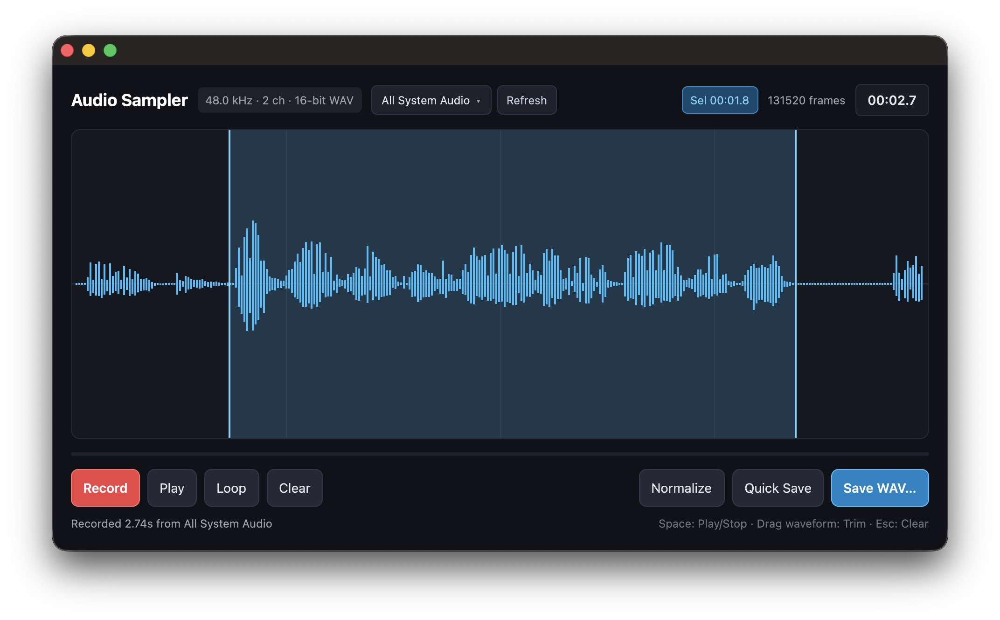

# Sampler

A macOS app for capturing audio from a running application (or the whole system) and saving parts of it as WAV samples.



Built in Rust with [gpui](https://crates.io/crates/gpui) for the UI, [ScreenCaptureKit](https://developer.apple.com/documentation/screencapturekit) for capture and [rodio](https://crates.io/crates/rodio) for playback.

It was created to test a workflow of establishing good agentic development practices with the help of [Matt Pocock's](https://github.com/mattpocock/skills/) and [Addy Osmani's skills](https://github.com/addyosmani/agent-skills) and then adding a new feature incorporating acceptance tests with augmented AI development skills from https://github.com/strangnet/agent-skills/tree/0.2.1/skills/engineering.

## Requirements

- macOS 13 (Ventura) or later
- Rust 1.85+ (the crate uses edition 2024)
- Xcode Command Line Tools (ScreenCaptureKit's Swift bridge links against the system Swift runtime)

## Build and run

```sh
cargo run --release
```

To build a double-clickable app bundle (ad-hoc signed):

```sh
scripts/bundle.sh          # writes target/Sampler.app
open target/Sampler.app
```

`bundle.sh` builds with `--offline` by default. Set `CARGO_BUILD_ARGS` to override, e.g. `CARGO_BUILD_ARGS= scripts/bundle.sh` to allow network access.

On first capture, macOS asks for **Screen & System Audio Recording** permission. Grant it in System Settings → Privacy & Security, then restart the app.

## Usage

1. Pick a source: **All System Audio** or a running application. **Refresh** re-reads the list of running apps; if the chosen app has quit, the source falls back to All System Audio.
2. **Record** to start capturing, **Stop** to finish. Recording again starts a fresh Recording.
3. Drag across the waveform to make a **Selection**. Drag its edges to resize it, or drag inside it to move it. **Escape** clears it.
4. **Play** (or **Space**) plays the Selection, or the whole Recording if there is none. **Loop** repeats playback.
5. Save:
   - **Quick Save** writes `sample-YYYYMMDD-HHMMSS.wav` to `~/Music/Sampler/`.
   - **Save WAV…** opens a save dialog; `.wav` is added if missing.
   - **Normalize** toggles peak-normalising exports to −0.1 dBFS.

**Clear** empties the Recording. Exports are 16-bit stereo WAV at 48 kHz.

Domain terms (Recording, Selection, Selection handle) are defined in [GLOSSARY.md](GLOSSARY.md).

## Development

```sh
git config core.hooksPath .githooks   # once per clone: run checks before each commit
scripts/check.sh                      # cargo fmt --check, clippy -D warnings, cargo test
```

CI runs the same script on macOS.

- `src/` – the app: `app.rs` (window and controls), `audio.rs` (capture, playback, WAV export), `selection.rs`, `waveform.rs`, `source_picker.rs`
- `tests/acceptance/` – acceptance tests that drive the app in-process; see [docs/acceptance-strategy.md](docs/acceptance-strategy.md)
- `docs/adr/` – architecture decision records
- `docs/agents/` – notes for coding agents (issue tracker, dependencies, gpui gotchas)

Issues are tracked in GitHub Issues.

## License

[MIT](LICENSE)
